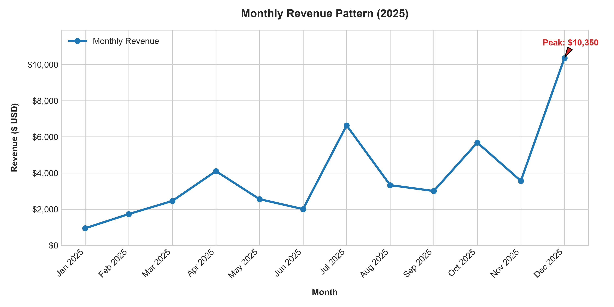
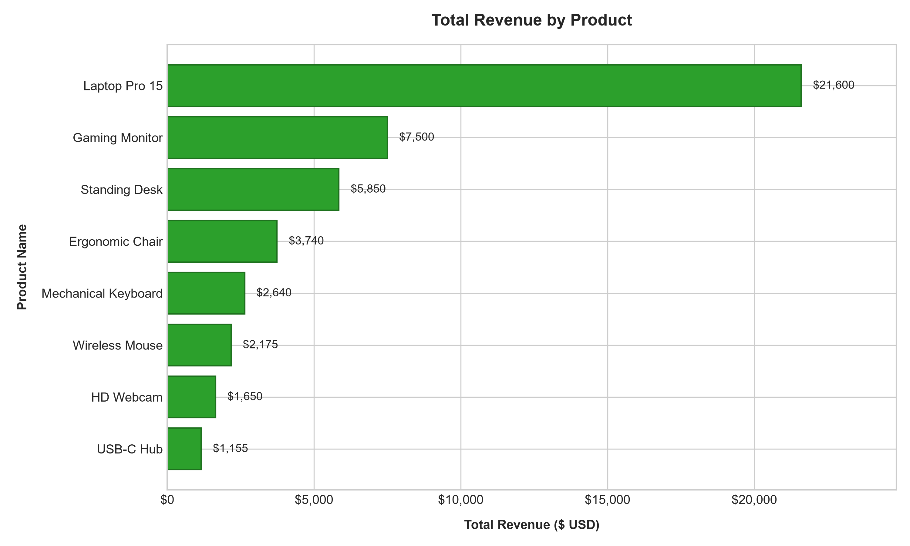
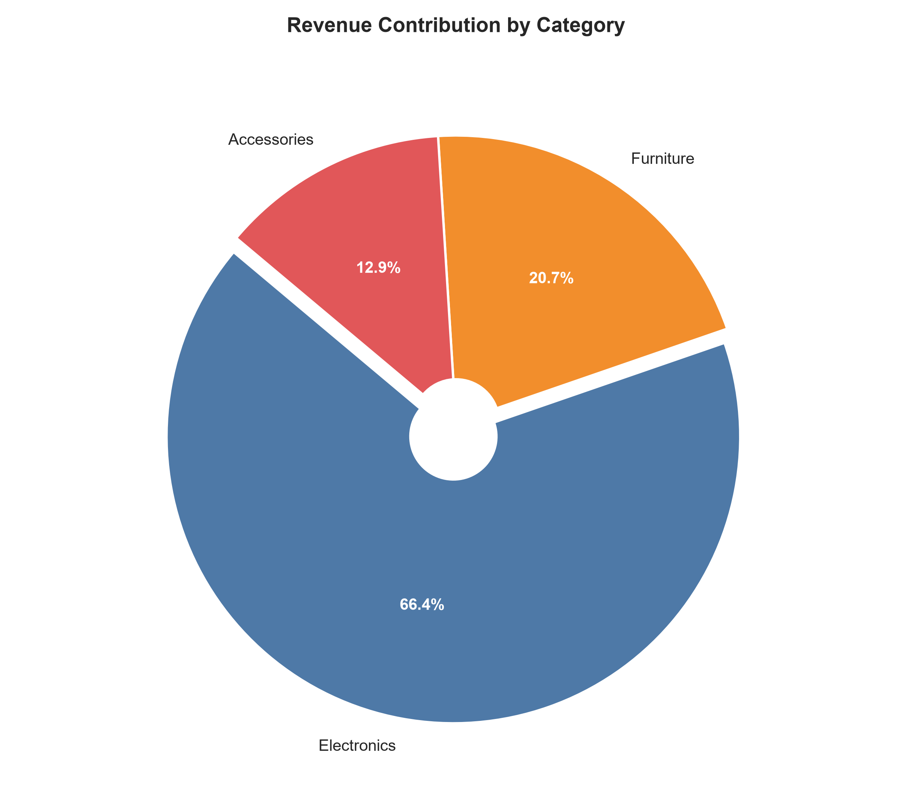
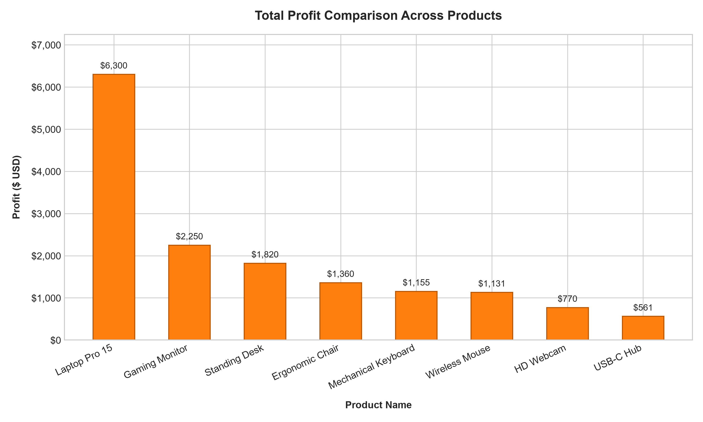

# Sales Data Visualization

A Python project that cleans raw sales data, calculates key revenue and profit metrics, and generates visual charts using Pandas and Matplotlib.

---

## About the Project

Real-world transaction data often contains missing values or bad formatting. In this project, I wrote a Python script (`main.py`) that takes a raw retail CSV file, cleans up invalid rows, calculates financial metrics (revenue, cost, profit, and margins), and saves four clean charts to a `charts/` folder.

---

## Script Output

When you run `main.py`, it processes the CSV file and prints an executive summary in the terminal:

```
[1/6] Raw dataset loaded: 27 records.
[2/6] Data cleaning complete: 2 invalid record(s) discarded. Remaining: 25
[3/6] Output directory ready at: ./charts/
[4/6] Generating Chart 1: Monthly Revenue Trend...
[4/6] Generating Chart 2: Revenue Comparison by Product...
[4/6] Generating Chart 3: Category Revenue Distribution...
[4/6] Generating Chart 4: Total Profit by Product...
[5/6] All 4 charts successfully rendered and saved to the 'charts/' folder.

==================================================
         EXECUTIVE PERFORMANCE SUMMARY
==================================================
Total Transactions Processed : 25
Gross Revenue                : $46,310.00
Total Operational Cost       : $30,963.00
Net Profit                   : $15,347.00
Overall Profit Margin        : 33.1%
==================================================
[6/6] Execution finished successfully.
```

### Summary Numbers
- **Total Valid Orders:** 25 orders processed
- **Gross Revenue:** $46,310.00
- **Total Costs:** $30,963.00
- **Net Profit:** $15,347.00
- **Overall Profit Margin:** 33.1%

---

## Charts Explained

The script automatically generates four charts and saves them as high-resolution PNGs:

### 1. Monthly Revenue Trend

* **What it shows:** Revenue by month across 2025.
* **Observation:** Sales start slow in January ($940), see a mid-year jump in July ($6,630), and peak in December ($10,350) due to year-end holiday demand. The peak month is automatically flagged with an annotation.

### 2. Revenue by Product

* **What it shows:** Total sales revenue generated by each item.
* **Observation:** The **Laptop Pro 15** generated the most revenue by far ($21,600), making up roughly 46% of total sales. Gaming monitors came second at $7,500.

### 3. Revenue Share by Category

* **What it shows:** Percentage breakdown across the three categories.
* **Observation:** **Electronics** accounts for 66.4% of total sales, followed by **Furniture** at 20.7% and **Accessories** at 12.9%.

### 4. Profit Comparison Across Products

* **What it shows:** Net profit contributed by each individual product.
* **Observation:** While laptops bring in the most raw profit ($6,300), smaller accessory items like the **Wireless Mouse** ($1,131 profit on $2,175 sales) and **USB-C Hub** have much higher profit margins (around 48% to 52%).

---

## Data Cleaning Notes

The raw file (`sales_data.csv`) includes intentionally corrupted rows to test the cleaning logic:
- **Order 1026:** Had an invalid date string (`INVALID_DATE`). `pd.to_datetime(..., errors='coerce')` converts it to `NaT`, and it gets dropped.
- **Order 1027:** Was missing the `Quantity` value. It gets removed by `dropna`.

Out of 27 raw rows, 2 bad records were filtered out, leaving 25 clean transactions for analysis.

---

## Project Structure

```
SalesDataVisualization/
├── charts/                           # Generated chart images
│   ├── 1_monthly_revenue_trend.png
│   ├── 2_revenue_by_product.png
│   ├── 3_category_revenue_share.png
│   └── 4_profit_by_product.png
├── main.py                           # Cleaning, calculation, and plotting logic
├── sales_data.csv                    # Raw sales dataset
├── .gitignore
└── README.md
```

---

## Dataset Format

The CSV file contains the following columns:

| Column | Description |
| :--- | :--- |
| `Order_ID` | Unique order number |
| `Date` | Date of purchase (`YYYY-MM-DD`) |
| `Product` | Item name |
| `Category` | Category (`Electronics`, `Accessories`, `Furniture`) |
| `Quantity` | Number of units ordered |
| `Unit_Price` | Retail selling price per unit |
| `Unit_Cost` | Cost to produce or buy per unit |

---

## How to Run

### 1. Clone the repository
```bash
git clone https://github.com/Sohan-2807/sales-data-visualization.git
cd sales-data-visualization
```

### 2. Set up a virtual environment (optional but recommended)
- **Windows:**
  ```powershell
  python -m venv venv
  .\venv\Scripts\activate
  ```
- **macOS / Linux:**
  ```bash
  python3 -m venv venv
  source venv/bin/activate
  ```

### 3. Install dependencies
```bash
pip install pandas matplotlib
```

### 4. Run the script
```bash
python main.py
```

The script will clean the data, print the summary table to your terminal, and save all 4 charts into the `charts/` folder.

---

## Built With
- **Python 3**
- **Pandas** for data manipulation and cleaning
- **Matplotlib** for chart plotting
